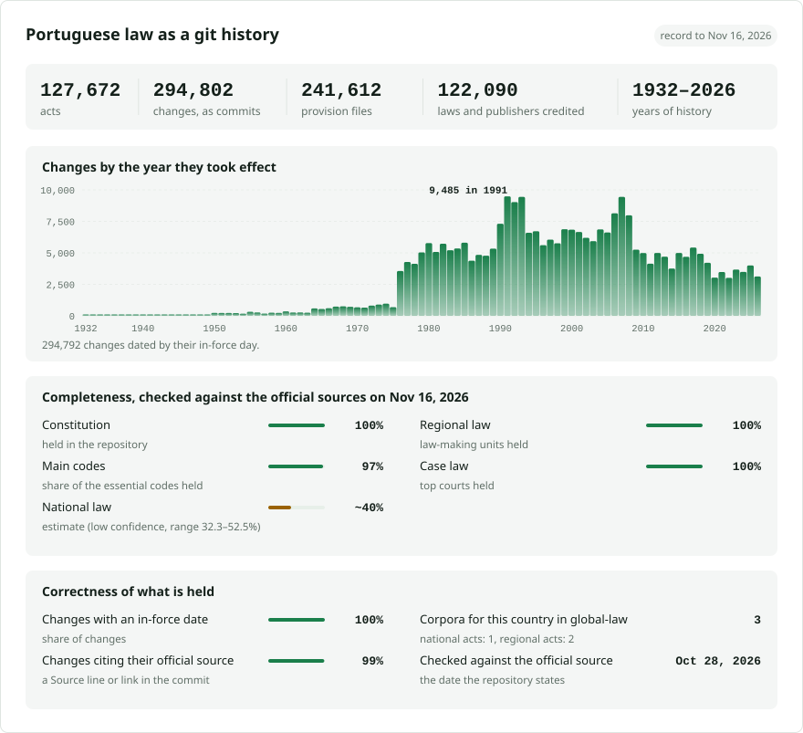

# Portugal: law history in git

**English** · **[Ou leia em português](README.md)**

<picture>
<source media="(prefers-color-scheme: dark)" srcset="data/effort-dark.svg">

</picture>

The law of Portugal as a git history: one file per article, one commit per version on the day it took effect, and the act that made each change as the commit's author. `git blame` names the act behind every line; `git log` lists every change to an article; picking a date gives the text in force that day.

Part of [lexifina/global-law](https://github.com/lexifina/global-law), one git history for every country's law: this is Portugal's national law, which global-law reads at `portugal/national/acts/`.

**What is in it now:** the Constitution with its seven revisions; 34 codes in [`code/`](code/), 29 of them with their dated history (each folder's README says which source); more than 134,000 acts of the Diário da República 1.ª série as published, from 1976 and, being added, the Diário do Governo from 1910, with the 2,098 Leis and Decretos-Leis in force also as consolidated text; more than 44,000 regulatory acts of the 2.ª série (regulamentos, including municipal ones, portarias, despachos normativos, Banco de Portugal and CMVM rules); and case law in [`jurisprudencia/`](jurisprudencia/): more than 174,000 decisions of the higher courts from the DGSI databases (STJ, STA, Relações, TCA Sul and Norte, Tribunal dos Conflitos), 27,794 Constitutional Court rulings and more than 6,800 CAAD tax arbitration decisions. The folder READMEs and [`data/`](data/) give the detail.

Each act is in `<kind>/<year>/<number>/` (`lei/2014/35/` is the Lei Geral do Trabalho em Funções Públicas, Lei n.º 35/2014, with its annex in `anexo/`), or in `act/<year>/` where its number has a letter, one file per article; the Constitution is in [`constitution/constituicao/`](constitution/constituicao/), and the Civil Code and the Labour Code (Código do Trabalho, approved by Lei n.º 7/2009) in `code/codigo-civil/` and `code/codigo-do-trabalho/`. Until 10 November 2026 each folder was named by the act's id (`codigo-do-trabalho/`): `git log --follow` and `git blame` follow the move, [`data/paths.json`](data/paths.json) maps each id to its folder (44 older acts kept theirs), and the last two commands below name the old folder.

The text is in Portuguese, as the Diário da República's consolidated legislation prints it. An English translation is not part of this record.

## Questions as git commands

| Question | Command |
| --- | --- |
| Every change to Article 238 of the Labour Code (length of annual leave) | `git log -p --follow --word-diff -- code/codigo-do-trabalho/artigo-238.md` |
| Which act wrote each line of Article 238? | `git blame code/codigo-do-trabalho/artigo-238.md` |
| Every version of the Labour Code, with the day each took effect | `git log --format="%h %(trailers:key=In-force,valueonly,separator=) %an" -- code/codigo-do-trabalho codigo-do-trabalho` |
| Article 238 as in force on 1 January 2012 | `python tools/em_vigor.py 2012-01-01 codigo-do-trabalho 238` |

**Outside git**, we also host this record publicly, for free:

- **[Ask Claude about Portuguese law](https://global-law.lexifina.com/v1/try_claude?country=portugal)**: opens Claude with a first question ready.
- **[Ask ChatGPT](https://global-law.lexifina.com/v1/try_chatgpt?country=portugal)**: the same question in ChatGPT.
- **[Search Portuguese law on our site](https://lexifina.com/law?country=portugal&q=f%C3%A9rias)**: a search for "férias" (annual leave), with each provision's text and its versions, no account needed.
- **[Developer REST API](https://global-law.lexifina.com/v1/search_law?query=f%C3%A9rias&jurisdiction=portugal)**: the same search as JSON, with no key. See the [documentation here](https://lexifina.com/api/global-law).

Both assistants read the record through the free Global law connector (MCP, `https://global-law.lexifina.com/mcp`); the first time, the chat gives you the link that adds it. Ask in Portuguese or in English.

**Host it yourself easily.** All it takes is git and Python, and the tools run on your machine:

```sh
git clone --depth 1 https://github.com/lexifina/global-law && cd global-law
python3 tools/countries.py add portugal/national/acts
python3 tools/law.py show 2026-01-01 portugal/national/acts/code/codigo-do-trabalho/artigo-238.md
```

Opened in Claude Code, Cursor, VS Code or Codex, the clone also starts a local MCP server with the same tools ([MCP.md](https://github.com/lexifina/global-law/blob/main/MCP.md)).

## Dates

Each commit is dated at noon, Europe/Lisbon, on the day the version took effect, and carries it in its `In-force:` trailer, beside `Published:`:

- for the Constitution and the two codes, the day the Diário da República gives each provision version (`DataEntradaVigor`); where it gives none, the commit says so and how it was dated;
- for each other act, its current text is dated the latest day one of its provisions took effect, and each earlier version is a `Kind: correction` commit whose `Corrects:` line gives the days it covers; they were added after the current text, so they come after it in git whatever their dates;
- git cannot store dates before 1970, so the four earlier commits (the Civil Code's first text, in force on 1 June 1967, and three acts of 1960, 1965 and 1968) are dated 1970-01-01, seconds apart, with the real day in `In-force:`. Ask for a date with `tools/em_vigor.py`, not `git log --before`.

Each change is credited to the act the Diário da República's amendment timeline names for it (`Lei n.º 23/2012`), declarations of rectification included; a change it names no act for is credited by date only when exactly one act has changes in force that day (`Evidence: date only`), otherwise to `Diário da República (INCM)`, labelled. The current text of each other act is credited to the Diário da República (INCM) as publisher.

## How it is checked

- `tools/check_repo.py` reads the Constitution and the two codes back from git on every day a version took effect and compares them with the Diário da República's consolidated text for that day, file by file and word for word against its raw text: 111 days, 196,180 files and 16,587,703 words, 0 mismatches.
- A second build from the same data gave the same hash for every one of the 148 law commits and 249 tags; `data/versoes.json` lists every text read, with its sha256.
- `tools/test_repo.py` checks that blame names an act, that the text changes across an amendment and that `git log --follow` works. The results are in [`REPRODUCE.md`](REPRODUCE.md), which describes the build of the first three acts only.
- [vulnerabilities/](vulnerabilities/README.en.md): possible drafting mistakes in this law, found by global-law's detectors and checked by hand. Not run yet.

## What it does not show

- **Other kinds of act.** 2.ª série acts that can name persons (appointments, staff notices, most despachos and avisos) are left out, and its portarias, acórdãos, pareceres and resoluções are metadata records without text; the regional acts of the Azores and Madeira and EU law are not included.
- **Earlier versions of most other acts.** 1,698 of the 2,098 have only their current text. For the other 400, history starts at the first dated change, as the Diário da República gives no in-force day for the original text; plain `git blame` on them names the publisher, while global-law's tools read the corrections.
- **Commencement the Diário da República does not model.** Some articles of the Labour Code were deferred to later legislation (Lei n.º 7/2009, artigo 14.º), and the Civil Code's artigos 1841.º to 1850.º took effect on 1 January 1968; both are shown from the act's first day.
- **The Civil Code from 1967 to 1975.** The amendment timeline starts in 1975, so earlier changes appear in its first later version, credited to the publisher. The Constitution's first text, as consolidated, ends at artigo 295.º and has no signatures until 1982.

## Sources

| Source | Kind | Past versions | Notes |
| --- | --- | --- | --- |
| [Diário da República](https://diariodarepublica.pt) (INCM), Legislação Consolidada | Official journal: consolidated legislation | yes, every provision version with the day it took effect | The text in force on each day and the amendment timeline naming each amending act, read through the calls its own pages make; the consolidated texts have no legal value, only the Diário da República as published is authoritative |

## Licence

See [`LICENSE`](LICENSE). The text is the Diário da República's, published by INCM under the public service of universal and free access to it (Decreto-Lei n.º 83/2016), and official texts such as laws are not protected by copyright (Código do Direito de Autor e dos Direitos Conexos, artigo 8.º, n.º 1); the history, commit messages, tables and tools are CC0 1.0.

No AI model wrote or changed legal text, and none is called when the history is built or checked; the scripts were written by an AI model (see [`REPRODUCE.md`](REPRODUCE.md)).

## Visualisations

- [visualisations/](visualisations/README.en.md): charts drawn from this repository. Not drawn yet.

## More

From [lexifina/global-law](https://github.com/lexifina/global-law):

- [FEATURES.md](https://github.com/lexifina/global-law/blob/main/FEATURES.md): every feature, and what every corpus must support (`git blame`, `law.py`, the MCP tools)
- [FAQ.md](https://github.com/lexifina/global-law/blob/main/FAQ.md): questions and answers · [CONTRIBUTING.md](https://github.com/lexifina/global-law/blob/main/CONTRIBUTING.md): proposing changes · [MCP.md](https://github.com/lexifina/global-law/blob/main/MCP.md): the MCP server · [REPRODUCE.md](https://github.com/lexifina/global-law/blob/main/REPRODUCE.md): how it was built · [CHANGELOG.md](https://github.com/lexifina/global-law/blob/main/CHANGELOG.md)
- [FRESHNESS.md](https://github.com/lexifina/global-law/blob/main/FRESHNESS.md): how current each corpus is · [Monitoring](https://github.com/lexifina/global-law/tree/main/monitoring): whether updates are running · [WATCHING.md](https://github.com/lexifina/global-law/blob/main/WATCHING.md): how each official source is watched for changes
- [performance/](https://github.com/lexifina/global-law/tree/main/performance): how fast the tools are, measured
- [visualisations/](https://github.com/lexifina/global-law/tree/main/visualisations): charts and bridges across the world's law
- [Vulnerabilities](https://github.com/lexifina/global-law/tree/main/vulnerabilities): mistakes in legislation as published
