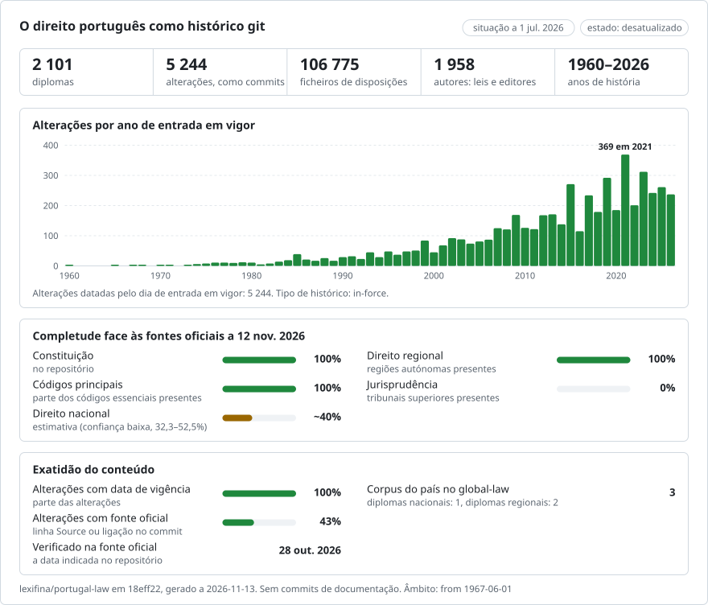

# O direito português, alteração a alteração

**Português** · [English](README.en.md)

<picture>
<source media="(prefers-color-scheme: dark)" srcset="data/pt/effort-dark.svg">

</picture>

Faz parte de [lexifina/global-law](https://github.com/lexifina/global-law), um único histórico git para o direito de todos os países: este é o direito nacional de Portugal, que o global-law lê em `portugal/national/acts/`.

Três atos portugueses como repositório git: a Constituição (Constituição da República Portuguesa, 1976), o Código
Civil (aprovado pelo Decreto-Lei n.º 47344, de 1966) e o Código do Trabalho (aprovado pela Lei n.º 7/2009). Cada ato
modificativo é um commit, atribuído a esse ato e datado do dia em que a sua alteração entrou em vigor, ao meio-dia em
Lisboa. O texto é o texto consolidado publicado no [Diário da República](https://diariodarepublica.pt) (Legislação
Consolidada).

## As perguntas, em comandos git

| Pergunta | Comando |
| --- | --- |
| O que dizia o artigo 7.º da Constituição em 1 de janeiro de 2000? | `python tools/em_vigor.py 2000-01-01 constituicao 7` |
| Toda a Constituição tal como estava em 1980 | `python tools/em_vigor.py 1980-01-01 constituicao` |
| O artigo 3.º do Código do Trabalho em 1 de janeiro de 2020 | `python tools/em_vigor.py 2020-01-01 codigo-do-trabalho 3` |
| O artigo 1577.º do Código Civil (casamento) em 1 de janeiro de 2009 | `python tools/em_vigor.py 2009-01-01 codigo-civil 1577` |
| Todas as alterações ao artigo 1577.º do Código Civil | `git log --follow --format="%ad %an" --date=short codigo-civil/artigo-1577.md` |
| Que ato escreveu cada parágrafo do artigo 7.º? | `git blame constituicao/artigo-007.md` |
| Todas as alterações ao artigo 7.º, com o ato e o dia | `git log --follow constituicao/artigo-007.md` |
| A alteração palavra a palavra de cada revisão | `git log -p --word-diff constituicao/artigo-007.md` |
| Tudo o que um ato alterou | `git show --stat atos/lei-constitucional-1-2004` |
| O que mudou no Código do Trabalho num dia | `git show --stat codigo-do-trabalho/2019-10-01` |
| Os atos modificativos com todos os seus dias | [`atos.csv`](atos.csv) |
| Alterações atribuídas apenas pela data (o DR não indica nenhum ato) | `git log --grep="Evidence: date only"` |
| Alterações para as quais o DR não indica nenhum ato | `git log --grep="sem ato indicado"` |
| Atos que alteraram o Código do Trabalho em 2019 | `git log --format="%an %s" --author="/2019" -- codigo-do-trabalho` |

## As datas, e qual delas usamos

Um ato português tem o dia em que foi publicado no Diário da República (`Published:`) e o dia em que a sua alteração
entrou em vigor (`In-force:`). **Os commits são datados do dia em que a alteração entrou em vigor**, ao meio-dia em
Lisboa, porque é esse dia que decide que texto se aplica. É o dia que o DR indica para cada versão de uma disposição
(`DataEntradaVigor`). Quando o DR não indica nenhum, o commit di-lo e explica como foi datado. O Código Civil entrou
em vigor em 1 de junho de 1967; o git não consegue guardar uma data anterior a 1970, pelo que esse commit é datado de
1 de janeiro de 1970 e o seu dia real consta de `In-force:`.

`tools/em_vigor.py` lê o trailer `In-force:`, pelo que dá a mesma resposta em qualquer fuso horário; o
`git rev-list --before` simples usa a hora local de quem o executa. No PowerShell, coloque entre aspas duplas um
argumento `ref:path` de `git show`. Depois de uma reconstrução deste repositório, atualize as tags com
`git fetch --force --tags`.

## O que significa «autor»

O autor de um commit é o ato que fez a alteração: `Lei n.º 93/2019` (com um endereço terminado em
`@diariodarepublica.invalid`, que não pode existir), de modo que `git blame` indica o ato. As declarações de
retificação e os acórdãos do Tribunal Constitucional que o DR enumera também são autores. O DR mantém, para cada ato
que consolida, uma cronologia de alterações que indica as versões de disposições criadas por cada ato modificativo;
uma alteração é atribuída ao ato que a cronologia indica para ela. Uma alteração para a qual a cronologia não indica
nenhum ato é atribuída apenas pela data quando exatamente um ato tem alterações em vigor nesse dia (com a etiqueta
`Evidence: date only`); caso contrário, o commit fica em nome do `Diário da República (INCM)`, com etiqueta. O
committer é sempre `Lexifina`.

## Como é verificado

`tools/check_repo.py` relê cada ato a partir do git em todos os dias em que uma versão entrou em vigor e compara-o com
o texto consolidado do DR para esse dia: ficheiro a ficheiro, e palavra a palavra com o texto em bruto, lido sem o
renderizador usado na construção. `tools/test_repo.py` verifica que os comandos acima funcionam. Os resultados estão
em [`REPRODUCE.md`](REPRODUCE.md).

## Ficheiros

Cada ato é uma pasta. Cada artigo é um ficheiro com o nome do seu número: `constituicao/artigo-007.md` é o artigo 7.º,
`codigo-do-trabalho/artigo-208-a.md` é o artigo 208.º-A do Código do Trabalho e `codigo-do-trabalho/lei-7-2009/`
contém os artigos da própria Lei n.º 7/2009 (o Código é o seu anexo); os artigos do Código Civil têm quatro algarismos
(`codigo-civil/artigo-1577.md`) e `codigo-civil/decreto-lei-47344/` contém os do decreto-lei que o aprovou. Os títulos
das divisões que começam antes de um artigo são linhas `##` no topo do seu ficheiro; o número do artigo é a linha `#`
e a sua epígrafe a linha `###`; cada parágrafo é uma linha. `preambulo.md` é o texto anterior ao primeiro artigo,
`assinatura.md` as assinaturas. Um artigo revogado é removido, porque deixa de fazer parte do texto em vigor; um
artigo suspenso é assinalado com `*(Suspenso)*`.

## O que não mostra

- Versões que o DR não consolida: o registo da Constituição começa com o texto original consolidado pelo DR (25 de
  abril de 1976), que termina no artigo 295.º e não tem assinaturas até 1982.
- Inícios de vigência que o DR não modela: a Lei n.º 7/2009, artigo 14.º, remeteu a entrada em vigor de alguns artigos
  do Código do Trabalho para legislação posterior, e os artigos 1841.º a 1850.º do Código Civil entraram em vigor em 1
  de janeiro de 1968; a consolidação do DR, e este registo, mostram-nos desde o primeiro dia do ato.
- Alterações ao Código Civil entre 1967 e 1975: a cronologia do DR começa em 1975, pelo que as alterações anteriores
  aparecem na primeira versão posterior, num commit em nome do editor, com etiqueta.
- Quando o texto do DR para um dia e os seus dias de versão divergem, o registo segue os dias de versão; todos os
  casos estão enumerados em REPRODUCE.md e em `data/versoes.json`.
- Qualquer ato além destes três. A mesma construção funciona para qualquer ato que o DR consolide: acrescente-o a
  `ACTS` em `tools/build.py`.

Os textos consolidados do DR não têm valor legal («sem valor legal»); só faz fé o Diário da República tal como
publicado.

## Como é construído

`tools/build.py` lê o DR e escreve este repositório de raiz; os mesmos dados dão os mesmos hashes. Cada passo, o
software, as decisões tomadas manualmente e o que um modelo de IA fez estão em [`REPRODUCE.md`](REPRODUCE.md). A pasta
de cada ato tem um `README.md` que enumera os seus artigos e quantas vezes cada um foi alterado.
[`corpus.json`](corpus.json) descreve o corpus para ferramentas que leem vários repositórios de direito da Lexifina.

## Licença

Ver [LICENSE](LICENSE): o texto legal provém do Diário da República (INCM), ao abrigo do serviço público de acesso
universal e gratuito a esse texto; o histórico, as mensagens de commit, as tabelas e as ferramentas são
disponibilizados ao abrigo da CC0 1.0. A questão de saber se os textos consolidados do DR podem ser republicados não
fica aqui resolvida, e o repositório é privado.

Esta é uma tradução da versão inglesa ([README.en.md](README.en.md)); em caso de divergência, prevalece a versão inglesa.

---

## Outros atos em vigor: apenas o texto atual

Desde 2026-11-03, o repositório contém também todas as leis e decretos-leis em vigor de que o Diário da República mantém um texto consolidado (Legislação Consolidada), cada um na sua própria pasta com o nome do ato (`lei-38-2025/`, `decreto-lei-57-a-2024/`), com os mesmos nomes de ficheiros que os três atos acima. Cada um é um commit com todo o seu texto consolidado em vigor em 2026-11-03: a versão mais antiga disponível aqui, atribuída ao Diário da República (INCM) como editor, com `Kind: consolidated`. O commit é datado do dia mais recente em que uma das suas disposições entrou em vigor (`In-force:`), pelo que dá o texto em vigor a partir desse dia; as redações anteriores são acrescentadas atrás dele quando o Diário da República as data (secção seguinte). Foram acrescentados por cima do histórico acima, pelo que os seus commits vêm depois dele, quaisquer que sejam as suas datas. A lista é [`data/atos-em-vigor.csv`](data/atos-em-vigor.csv).

Desde 2026-11-03 o repositório inclui também todas as leis e decretos-leis em vigor com texto consolidado no Diário da República, cada um com o texto em vigor nesse dia (a versão mais antiga disponível aqui), datado do dia mais recente em que uma das suas disposições entrou em vigor. Lista: [`data/atos-em-vigor.csv`](data/atos-em-vigor.csv).

## Versões anteriores dos outros atos

Desde 2026-11-03, os atos da lista acima incluem também as suas versões anteriores, quando a legislação consolidada do Diário da República as data: o texto de cada ato em todos os dias em que entrou em vigor uma alteração a esse ato, cada disposição na versão em vigor nesse dia segundo a sua própria data de entrada em vigor (para uma versão sem data: o dia em que foi publicada a retificação que a indica ou, na falta desta, o primeiro texto consolidado que a mostra). O texto original não tem dia de entrada em vigor nesses dados, pelo que o histórico de um ato começa na sua primeira alteração datada. Cada versão anterior é um commit acrescentado depois do texto atual, `Kind: correction`, com `In-force:` o seu primeiro dia e `Corrects: <folder> <from>..<to>` os dias que abrange (até à véspera da versão seguinte), `Supersedes: none`, `Act-path:` a pasta do ato e uma linha `Files:` por ficheiro; é atribuído ao ato modificativo que o DR indica para as suas alterações. Uma última correção por ato repõe o texto atual na ponta (intervalo aberto). Os leitores que respeitam os commits de correção (ferramentas que leem `Corrects`) dão o texto de qualquer dia a partir da primeira alteração datada; a lista, com o número de versões por ato, é [`data/versoes-anteriores.csv`](data/versoes-anteriores.csv). Os atos mais alterados vêm primeiro; os restantes seguem-se em partes posteriores.

Desde 2026-11-03, os atos da lista acima passam a ter também as versões anteriores que a legislação consolidada do Diário da República data, cada uma num commit `Kind: correction` acrescentado depois do texto em vigor e creditado ao ato que a alterou. Lista: [`data/versoes-anteriores.csv`](data/versoes-anteriores.csv).

## Mais informação

Do repositório [lexifina/global-law](https://github.com/lexifina/global-law) (páginas em inglês):

- [FEATURES.md](https://github.com/lexifina/global-law/blob/main/FEATURES.md): todas as funcionalidades e o que cada corpus tem de suportar (`git blame`, `law.py`, ferramentas MCP)
- [FAQ.md](https://github.com/lexifina/global-law/blob/main/FAQ.md): perguntas e respostas · [CONTRIBUTING.md](https://github.com/lexifina/global-law/blob/main/CONTRIBUTING.md): propor alterações · [MCP.md](https://github.com/lexifina/global-law/blob/main/MCP.md): servidor MCP · [REPRODUCE.md](https://github.com/lexifina/global-law/blob/main/REPRODUCE.md): como foi construído · [CHANGELOG.md](https://github.com/lexifina/global-law/blob/main/CHANGELOG.md)
- [FRESHNESS.md](https://github.com/lexifina/global-law/blob/main/FRESHNESS.md): quão atualizado está cada corpus · [Monitorização](https://github.com/lexifina/global-law/tree/main/monitoring): se as atualizações estão a funcionar · [WATCHING.md](https://github.com/lexifina/global-law/blob/main/WATCHING.md): como cada fonte oficial é vigiada para detetar alterações
- [performance/](https://github.com/lexifina/global-law/tree/main/performance): a rapidez das ferramentas, medida
- [visualisations/](https://github.com/lexifina/global-law/tree/main/visualisations): gráficos e ligações através do direito de todo o mundo
- [Vulnerabilidades](https://github.com/lexifina/global-law/tree/main/vulnerabilities): erros nos diplomas tal como foram publicados
