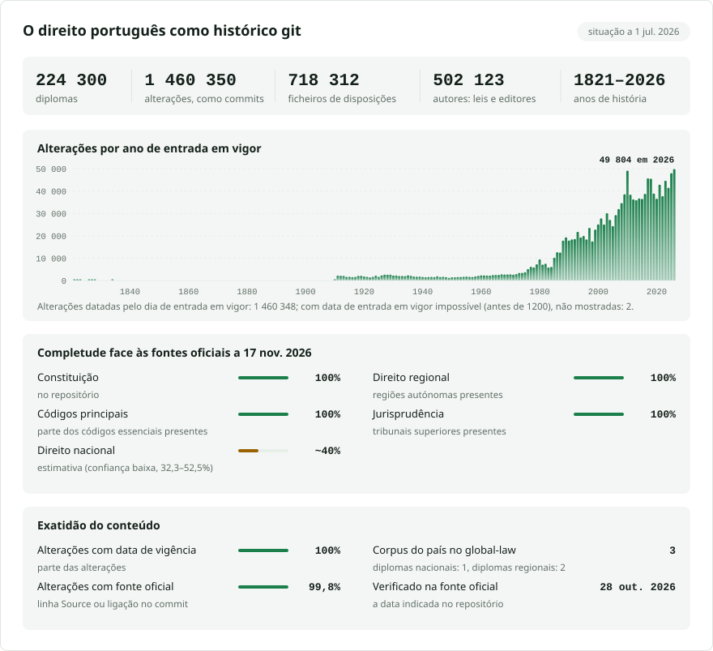

# Portugal: história do direito em git

**Português** · **[Or read it in English](README.en.md)**

<picture>
<source media="(prefers-color-scheme: dark)" srcset="data/pt/effort-dark.svg">

</picture>

O direito de Portugal como histórico git: um ficheiro por artigo, um commit por versão no dia em que entrou em vigor e, como autor do commit, o ato que fez cada alteração. `git blame` indica o ato por detrás de cada linha; `git log` lista todas as alterações a um artigo; escolhendo uma data obtém-se o texto em vigor nesse dia.

Faz parte de [lexifina/global-law](https://github.com/lexifina/global-law), um único histórico git para o direito de todos os países: este é o direito nacional de Portugal, que o global-law lê em `portugal/national/acts/`.

**O que contém agora:** a Constituição, o Código Civil e o Código do Trabalho, com as suas 148 versões desde 1967; e todas as outras leis e decretos-leis em vigor que o Diário da República consolida, 2098 atos (502 leis e 1596 decretos-leis), cada um com o texto em vigor em 3 de novembro de 2026, 400 deles também com as suas 2998 versões anteriores. [`data/atos-em-vigor.csv`](data/atos-em-vigor.csv) lista os 2098 atos, [`data/versoes-anteriores.csv`](data/versoes-anteriores.csv) os que têm versões anteriores e [`atos.csv`](atos.csv) os atos que alteraram os três primeiros, com os seus dias.

Cada ato está em `<tipo>/<ano>/<número>/` (`lei/2014/35/` é a Lei Geral do Trabalho em Funções Públicas, Lei n.º 35/2014, com o seu anexo em `anexo/`), ou em `act/<ano>/` quando o seu número tem uma letra, com um ficheiro por artigo; a Constituição está em [`constitution/constituicao/`](constitution/constituicao/), e o Código Civil e o Código do Trabalho (aprovado pela Lei n.º 7/2009) em `code/codigo-civil/` e `code/codigo-do-trabalho/`. Até 10 de novembro de 2026, cada pasta tinha o nome do identificador do ato (`codigo-do-trabalho/`): `git log --follow` e `git blame` acompanham a mudança, [`data/paths.json`](data/paths.json) faz corresponder cada identificador à sua pasta (44 atos mais antigos mantiveram a sua) e os dois últimos comandos abaixo usam a pasta antiga.

O texto está em português, tal como a legislação consolidada do Diário da República o publica. Uma tradução para inglês não faz parte deste registo.

## Perguntas em comandos git

| Pergunta | Comando |
| --- | --- |
| Todas as alterações ao artigo 238.º do Código do Trabalho (duração do período de férias) | `git log -p --follow --word-diff -- code/codigo-do-trabalho/artigo-238.md` |
| Que ato escreveu cada linha do artigo 238.º? | `git blame code/codigo-do-trabalho/artigo-238.md` |
| Todas as versões do Código do Trabalho, com o dia em que cada uma entrou em vigor | `git log --format="%h %(trailers:key=In-force,valueonly,separator=) %an" -- code/codigo-do-trabalho codigo-do-trabalho` |
| O artigo 238.º em vigor em 1 de janeiro de 2012 | `python tools/em_vigor.py 2012-01-01 codigo-do-trabalho 238` |

**Fora do git**, também disponibilizamos este registo publicamente e de forma gratuita:

- **[Pergunte ao Claude sobre o direito português](https://global-law.lexifina.com/v1/try_claude?country=portugal)**: abre o Claude com uma primeira pergunta pronta.
- **[Pergunte ao ChatGPT](https://global-law.lexifina.com/v1/try_chatgpt?country=portugal)**: a mesma pergunta no ChatGPT.
- **[Pesquise no direito português no nosso site](https://lexifina.com/law?country=portugal&q=f%C3%A9rias)**: uma pesquisa de «férias», com o texto de cada disposição e as suas versões, sem conta.
- **[API REST para programadores](https://global-law.lexifina.com/v1/search_law?query=f%C3%A9rias&jurisdiction=portugal)**: a mesma pesquisa em JSON, sem chave. A documentação está [aqui](https://lexifina.com/api/global-law).

Os dois assistentes leem o registo através do conector gratuito Global law (MCP, `https://global-law.lexifina.com/mcp`); da primeira vez, a conversa dá-lhe a ligação que o adiciona. Pergunte em português ou em inglês.

**Aloje-o facilmente por conta própria.** Basta o git e o Python, e as ferramentas correm no seu computador:

```sh
git clone --depth 1 https://github.com/lexifina/global-law && cd global-law
python3 tools/countries.py add portugal/national/acts
python3 tools/law.py show 2026-01-01 portugal/national/acts/code/codigo-do-trabalho/artigo-238.md
```

Aberto no Claude Code, no Cursor, no VS Code ou no Codex, o clone inicia também um servidor MCP local com as mesmas ferramentas ([MCP.md](https://github.com/lexifina/global-law/blob/main/MCP.md)).

## Datas

Cada commit é datado ao meio-dia, hora de Lisboa (Europe/Lisbon), do dia em que a versão entrou em vigor, e indica esse dia no seu trailer `In-force:`, ao lado de `Published:`:

- para a Constituição e os dois códigos, o dia que o Diário da República indica para cada versão de uma disposição (`DataEntradaVigor`); quando não indica nenhum, o commit di-lo e explica como foi datado;
- para cada um dos outros atos, o texto atual é datado do dia mais recente em que uma das suas disposições entrou em vigor, e cada versão anterior é um commit `Kind: correction` cuja linha `Corrects:` indica os dias que abrange; foram acrescentadas depois do texto atual, pelo que surgem depois dele no git, sejam quais forem as suas datas;
- o git não consegue guardar datas anteriores a 1970, pelo que os quatro commits anteriores (o primeiro texto do Código Civil, em vigor desde 1 de junho de 1967, e três atos de 1960, 1965 e 1968) são datados de 1970-01-01, com segundos de intervalo, e o dia real consta de `In-force:`. Para perguntar por uma data, use `tools/em_vigor.py`, não `git log --before`.

Cada alteração é atribuída ao ato que a cronologia de alterações do Diário da República indica para ela (`Lei n.º 23/2012`), incluindo as declarações de retificação; uma alteração para a qual não indica nenhum ato é atribuída apenas pela data quando exatamente um ato tem alterações em vigor nesse dia (`Evidence: date only`) e, caso contrário, ao `Diário da República (INCM)`, com etiqueta. O texto atual de cada um dos outros atos é atribuído ao Diário da República (INCM), como editor.

## Como é verificado

- `tools/check_repo.py` lê a Constituição e os dois códigos a partir do git em cada dia em que uma versão entrou em vigor e compara-os com o texto consolidado do Diário da República para esse dia, ficheiro a ficheiro e palavra a palavra com o texto em bruto: 111 dias, 196 180 ficheiros e 16 587 703 palavras, 0 diferenças.
- Uma segunda construção a partir dos mesmos dados deu o mesmo hash para cada um dos 148 commits de lei e das 249 tags; `data/versoes.json` lista cada texto lido, com o seu sha256.
- `tools/test_repo.py` verifica que o blame indica um ato, que o texto muda com uma alteração e que `git log --follow` funciona. Os resultados estão em [`REPRODUCE.md`](REPRODUCE.md), que descreve apenas a construção dos três primeiros atos.

## O que não mostra

- **Outros tipos de ato.** Apenas a Constituição, leis e decretos-leis: não há portarias, decretos regulamentares, resoluções, atos regionais, jurisprudência nem direito da UE; nem atos que já não estão em vigor.
- **As versões anteriores da maioria dos outros atos.** 1698 dos 2098 têm apenas o texto atual. Para os outros 400, o histórico começa na primeira alteração datada, porque o Diário da República não indica dia de entrada em vigor para o texto original; o `git blame` simples indica neles o editor, enquanto as ferramentas do global-law leem as correções.
- **A entrada em vigor que o Diário da República não modela.** Alguns artigos do Código do Trabalho ficaram dependentes de legislação posterior (Lei n.º 7/2009, artigo 14.º), e os artigos 1841.º a 1850.º do Código Civil entraram em vigor em 1 de janeiro de 1968; ambos são mostrados desde o primeiro dia do ato.
- **O Código Civil de 1967 a 1975.** A cronologia de alterações começa em 1975, pelo que as alterações anteriores aparecem na sua primeira versão posterior, atribuídas ao editor. O primeiro texto da Constituição, tal como consolidado, termina no artigo 295.º e não tem assinaturas até 1982.

## Fontes

| Fonte | Tipo | Versões anteriores | Notas |
| --- | --- | --- | --- |
| [Diário da República](https://diariodarepublica.pt) (INCM), Legislação Consolidada | Jornal oficial: legislação consolidada | sim, cada versão de cada disposição com o dia em que entrou em vigor | O texto em vigor em cada dia e a cronologia de alterações que indica cada ato modificativo, lidos através dos pedidos que as suas próprias páginas fazem; os textos consolidados não têm valor legal, só o Diário da República tal como publicado faz fé |

## Licença

Ver [`LICENSE`](LICENSE). O texto é o do Diário da República, publicado pela INCM no âmbito do serviço público de acesso universal e gratuito ao mesmo (Decreto-Lei n.º 83/2016), e os textos oficiais, como as leis, não são protegidos por direito de autor (Código do Direito de Autor e dos Direitos Conexos, artigo 8.º, n.º 1); o histórico, as mensagens dos commits, as tabelas e as ferramentas estão em CC0 1.0.

Nenhum modelo de IA escreveu ou alterou texto legal, e nenhum é chamado quando o histórico é construído ou verificado; os scripts foram escritos por um modelo de IA (ver [`REPRODUCE.md`](REPRODUCE.md)).

Esta é uma tradução da versão inglesa ([README.en.md](README.en.md)); se divergirem, prevalece a versão inglesa.

## Mais informação

Do repositório [lexifina/global-law](https://github.com/lexifina/global-law) (páginas em inglês):

- [FEATURES.md](https://github.com/lexifina/global-law/blob/main/FEATURES.md): todas as funcionalidades e o que cada corpus tem de suportar (`git blame`, `law.py`, ferramentas MCP)
- [FAQ.md](https://github.com/lexifina/global-law/blob/main/FAQ.md): perguntas e respostas · [CONTRIBUTING.md](https://github.com/lexifina/global-law/blob/main/CONTRIBUTING.md): propor alterações · [MCP.md](https://github.com/lexifina/global-law/blob/main/MCP.md): servidor MCP · [REPRODUCE.md](https://github.com/lexifina/global-law/blob/main/REPRODUCE.md): como foi construído · [CHANGELOG.md](https://github.com/lexifina/global-law/blob/main/CHANGELOG.md)
- [FRESHNESS.md](https://github.com/lexifina/global-law/blob/main/FRESHNESS.md): quão atualizado está cada corpus · [Monitorização](https://github.com/lexifina/global-law/tree/main/monitoring): se as atualizações estão a funcionar · [WATCHING.md](https://github.com/lexifina/global-law/blob/main/WATCHING.md): como cada fonte oficial é vigiada para detetar alterações
- [performance/](https://github.com/lexifina/global-law/tree/main/performance): a rapidez das ferramentas, medida
- [visualisations/](https://github.com/lexifina/global-law/tree/main/visualisations): gráficos e ligações através do direito de todo o mundo
- [Vulnerabilidades](https://github.com/lexifina/global-law/tree/main/vulnerabilities): erros nos diplomas tal como foram publicados
