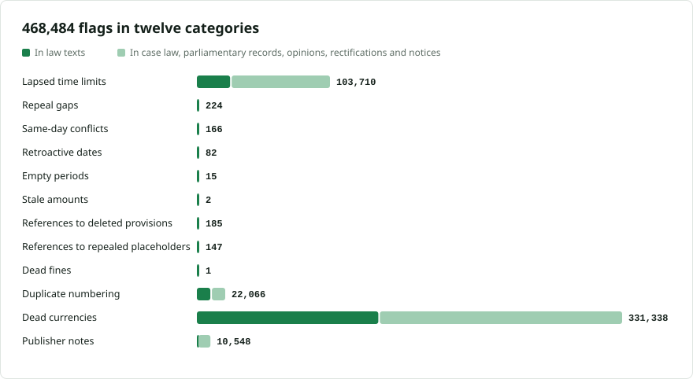

# Vulnerabilities in Portuguese law

[Português](README.md) · **English**

<picture>
<source media="(prefers-color-scheme: dark)" srcset="img/flags-by-category-dark.svg">

</picture>

The vulnerability detectors from [lexifina/global-law](https://github.com/lexifina/global-law/tree/main/vulnerabilities) look for mechanical mistakes in legislation: a rule applying "until" a date that has passed, a time limit extended only after it had run out, an amount changed in one place but not in another, a reference to an article that has been repealed. global-law's published list (9 November 2026) covered Portugal with 132 flags from an earlier copy of this repository: 98 repeal gaps, 19 references to deleted provisions, 8 lapsed time limits, 4 same-day conflicts and 3 retroactive dates. This is a run over this repository only, at commit [`6a2506e`](https://github.com/lexifina/portugal-law/commit/6a2506e545e0dcf20a72cb0448ca4336a188d922), read on 17 November 2026. The repository has grown since that list: besides the Constitution, the codes and the acts with a consolidated text, it now holds 226,636 acts as the Diário da República and the Diário do Governo published them (each a `texto.md`), the regulatory acts of the 2nd series, case law and parliamentary records, 1,466,570 commits in all.

**In short:** the detectors raised 468,484 flags; 178,552 of them are in law texts. A language model reviewed 218 of the strongest, arguing each one for and against; 38 survived. Checked by hand in this repository, three of them look like real mistakes in Portuguese law. Article 528(5) of the Commercial Companies Code still fines anyone who fails to make "the communications provided for in Articles 447 and 448 of this Code", but Lei 15/2017, which abolished bearer securities, repealed Article 448 (the shareholders' notice of their holdings of bearer shares) from 4 May 2017; Article 528 has been amended twice since and still cites it. Portaria 179/2011 says it "keeps" the option of paying court fees in two instalments (Article 44(2) of Portaria 419-A/2009), but the option had ended on 31 December 2010 and the Portaria took effect on 3 May 2011 with no retroactive wording; the next extension, Portaria 1/2012, did take effect from 1 January. And Decreto-Lei 10/2024, which reforms and simplifies licensing in planning, land use and industry, sets 1 January 2024 as the entry into force of its amendments to Article 1422 of the Civil Code and to the General Regulation on Urban Buildings, a week before the decree was published on 8 January. Five more are real gaps, but chosen or forced rather than overlooked: three State Budgets passed late (2016, 2020 and 2022) restored a tax incentive and, twice, a stamp-duty surcharge that had already expired, and a tax may not be retroactive (Constitution, Article 103(3)); two portarias reset deadlines that had passed and say why. Of the other 30, 10 come from how this repository and the Diário da República date changes or lay out the acts, 8 are lawful, 3 are misreadings by a detector, 1 is spent and 8 could not be verified because this repository does not hold the act that made the change (seven regional decrees of the Azores and Madeira and one of their extensions). Reading the categories the model does not review turned up no other likely mistake; 141,375 flags in law texts are amounts in escudos (and réis, the currency before 1911), almost all in acts as published before 2002. Later, this will be formalised in Lean, similar to our work on [the US tax code](https://lexifina.com/blog/formalizing-the-us-tax-code) and [US case law](https://lexifina.com/blog/formalizing-all-us-case-law-in-lean).

A flag is a prompt to look, not legal advice, and nothing here has been tested in court.

## Flags by category

| Category | What it looks for | Flags | In law texts | Reviewed | Survived review |
| --- | --- | ---: | ---: | ---: | ---: |
| Lapsed time limits | Text still applying a rule "until" a date that has passed | 103,710 | 25,883 | 41 | 0 |
| Repeal gaps | A provision that had no text for a while and then came back | 224 | 224 | 40 | 4 |
| Same-day conflicts | Two acts changing the same provision on the same day | 166 | 166 | 40 | 4 |
| Retroactive or pre-publication dates | A rule in force before it was made or published | 82 | 82 | 40 | 12 |
| Empty periods | A time limit extended by an act that took effect after it had run out | 15 | 15 | 15 | 11 |
| Stale amounts | An amount changed in one place but still standing elsewhere | 2 | 2 | 2 | 1 |
| References to deleted provisions | A provision citing an article that no longer exists | 185 | 185 | 40 | 6 |
| References to repealed placeholders | A provision citing an article whose text is only "(Revogado.)" | 147 | 147 | 0 | 0 |
| Dead fines | A penalty for breaching an article that has been repealed | 1 | 1 | 0 | 0 |
| Duplicate numbering | Two units with the same number in one file | 22,066 | 10,469 | 0 | 0 |
| Dead currencies | Amounts in currencies no longer in use | 331,338 | 141,375 | 0 | 0 |
| Publisher notes | Marks such as "(sic)" and phrases that flag failed amendments in other countries | 10,548 | 3 | 0 | 0 |

"In law texts" counts every file of an act: the Constitution, the codes, laws, decree-laws, regional legislative decrees, regulatory decrees, portarias, despachos and resolutions, the regulations of the 2nd series and the acts of the official journal of Madeira (JORAM), with each act's preamble, annexes and signatures. The other flags are in the court decisions (`jurisprudencia/`, the `acordao*/` folders and `assento/`), the parliamentary records (`parlamento/`), the opinions (`parecer*/`), the rectifications and declarations (`rectificacao/`, `declaracao*/`, `errata/`), the notices (`aviso/`, `anuncio/`, `edital/`, `nota/`, `circular/`), the election maps (`mapa*/`), ANACOM's decisions, motions and messages, and the README files. Most flags in law texts are in an act's `texto.md`, the act as the Diário da República published it, not as later amended: 23,598 of the 25,883 lapsed time limits and 139,278 of the 141,375 dead currencies. They show what an act said on the day it was published, often long ago, not a rule in force today. The search for dead currencies now reads the escudo as Portuguese law wrote it ("1.000$00", the "$" only between digits), "Esc." before an amount (not "Esc. 1:1000", a map scale), "contos" (thousands of escudos) and "réis"; before, it read only the word "escudos". The reference search now reads the article files by their names (`artigo-0001.md`, `artigo-010-a.md` for Article 10-A), so the first article of a chapter, whose file opens with the chapter's headings, is no longer missed or read as a reference to itself. The search for publisher notes no longer takes "não pode ser realizado" (a rule: "cannot be done") or the "SIC" of the Natura 2000 sites (Sítios de Importância Comunitária) for a note: 13,983 flags became 10,548, of which 10,465 are in court decisions. A repealed article here either loses its file or keeps it with the text "(Revogado.)", which is why there are flags in both reference categories.

*Edge cases: the 38 flags that survived the review, grouped by what they turned out to be, and what the other flags are, in [EDGE-CASES.en.md](EDGE-CASES.en.md).*

## Problems found in this repository

- **Repealed articles of the Penal Code back in force from 2007:** Article 3 of [Lei 31/2004](https://github.com/lexifina/portugal-law/blob/6a2506e545e0dcf20a72cb0448ca4336a188d922/lei/2004/31/artigo-003.md) repealed Articles 236, 238, 239, 241 and 242 of the Penal Code (from 21 August 2004), and Lei 100/2003, as the republication below notes, Article 237. In this repository the six articles come back with their old text on 15 September 2007 ([the change](https://github.com/lexifina/portugal-law/commit/79768997caf6db671f3715484740c7c6282b134b)), credited to Lei 59/2007 because the Diário da República's amendment timeline lists them as "added" by it; but the republication of the Code that Lei 59/2007 itself carries marks each one "(Revogado pela Lei n.º 31/2004, de 22 de Julho.)" ([Article 241 there](https://github.com/lexifina/portugal-law/blob/6a2506e545e0dcf20a72cb0448ca4336a188d922/lei/2007/59/anexo/artigo-241.md)). A reader of [`code/codigo-penal/artigo-241.md`](https://github.com/lexifina/portugal-law/blob/6a2506e545e0dcf20a72cb0448ca4336a188d922/code/codigo-penal/artigo-241.md) (war crimes against civilians) or of `artigo-239.md` (genocide), or of the Code on any date since 2007, sees repealed crimes as in force.
- **The urban-lease articles of the Civil Code repealed three years late:** Article 3(1)(a) of [Decreto-Lei 321-B/90](https://github.com/lexifina/portugal-law/blob/6a2506e545e0dcf20a72cb0448ca4336a188d922/act/1990/decreto-lei-321-b/texto.md), which approved the Urban Lease Regime, repealed Articles 1083 to 1120 of the Civil Code from 14 November 1990 (30 days after publication, Article 2(1)). This repository removes them on 22 August 1993, with no act named ([the change](https://github.com/lexifina/portugal-law/commit/1841ac5a1015eaafc66781cfc9c3504fe05dbefa)).
- **A repeal dated a year early:** Decreto-Lei 503/99 (accidents at work and occupational diseases in public employment), published on 20 November 1999, repealed Article 7 of Decreto Regulamentar 41/90 (medical boards; Article 57(e)) and took effect "on day 1 of the 6th month after its publication" (Article 58), that is 1 May 2000. This repository dates the repeal 1 May 1999 ([the change](https://github.com/lexifina/portugal-law/commit/6543c0a1aa73ba518f8e730a86c5c7097910080e)), the day the Diário da República gives.
- **An act as published beside its consolidated articles:** 480 act folders hold both `texto.md`, the act as published, and the files of its consolidated articles; read as the current text, `texto.md` still holds every provision later amended or repealed (one reference to a deleted provision comes from this: [Decreto Regulamentar 68/85](https://github.com/lexifina/portugal-law/blob/6a2506e545e0dcf20a72cb0448ca4336a188d922/decreto-regulamentar/1985/68/texto.md), Article 53).

## Files

| File | What it holds |
| --- | --- |
| [data/flags/](data/flags/) | Every flag, one row per provision and issue, one file per category; the two largest are gzipped (`lapsed-time-limits.csv.gz`, `dead-currencies.csv.gz`), as one file would pass GitHub's 100 MB limit |
| [data/reviewed.csv](data/reviewed.csv) | The 218 flags the model reviewed, with its verdict and reason |
| [data/by_category.csv](data/by_category.csv) | The counts in the table above |
| [tools/](tools/) | The scripts that made this run |

Columns: `category` and `category_pt` (the category in English and Portuguese), `detector`, `kind` (`law` or `other`), `path` (the file in this repository; for a retroactive date, the first file the act changed that day), `date` (the date the flag turns on), `reference` (the act or line involved), `summary`, `score` (the detector's ranking, 0 to 1), `review` (`artefact`, `lawful` or `candidate_defect`), `survives_rebuttal`, `review_note` (the model's reason, in English), `url` (the provision at the commit that was read, or, for a retroactive date, the commit that made the act's version on that day).

## How it was made

- **Detectors:** global-law's [vulnerabilities/scripts](https://github.com/lexifina/global-law/tree/main/vulnerabilities/scripts), run on this repository at commit `6a2506e`. The history table the detectors read was built from this repository's own commits (the act that made each change, its `In-force` date and its `Kind`). Commits whose `Kind` is the type of the act that made the change (`Decreto-Lei`, `Lei`, `Portaria`, `Decreto Legislativo Regional` and the rest), `original` (an act as published), `consolidated` (an act's current consolidated text) or none (a change the Diário da República made without naming an act) count as law: 228,752 commits. Earlier versions added after the current text (`correction`), records without text (`metadata`, `issue`), court decisions, parliamentary records, opinions, reports and documentation are left out. With 1,466,570 commits and 11 GB of current text, several scans were changed to read the repository as a stream rather than all at once (see [tools/](tools/)). The detectors carry the fixes global-law's scripts received in the runs on other country repositories, and the Portuguese ones above.
- **Model review:** gpt-5.4-mini, the 40 strongest flags per category, and the 40 strongest lapsed time limits in law texts. One pass says whether a flag is real, a second argues that it is not. Empty periods use global-law's own review for that category, on all 15 flags, followed by the same second pass. The model does not review references to repealed placeholders, dead fines, duplicate numbering, dead currencies or publisher notes. global-law's own list used a different model.
- **Hand check:** every flag that survived was read in this repository's history and texts, and in the extending or citing act where this repository holds it (Leis 15/2017, 31/2004, 59/2007 and the State Budget laws for 2016, 2020 and 2022; Decretos-Leis 10/2024, 30/70, 278/2009, 321-B/90 and 503/99; Portarias 1/2012, 96/2018, 122/2016, 179/2011, 278/2011 and 374/2015; and Decreto Legislativo Regional 14/2019/M as JORAM published it). The dead fine and the 3 publisher notes in law texts were read, as were a sample of the references to repealed placeholders, the duplicate numbers and the dead currencies by the words matched.

To report a correction, open an issue with the provision and an official source.

## Licence

The lists and notes are Lexifina's, dedicated to the public domain under CC0 1.0, like this repository's other own contributions. Quoted law text is that of the Diário da República, published by the INCM as a public service of universal and free access (Decreto-Lei 83/2016); official texts such as laws are not protected by copyright (Code of Copyright and Related Rights, Article 8(1)). The consolidated texts have no legal value: only the Diário da República as published is authentic. See [LICENSE](../LICENSE).
